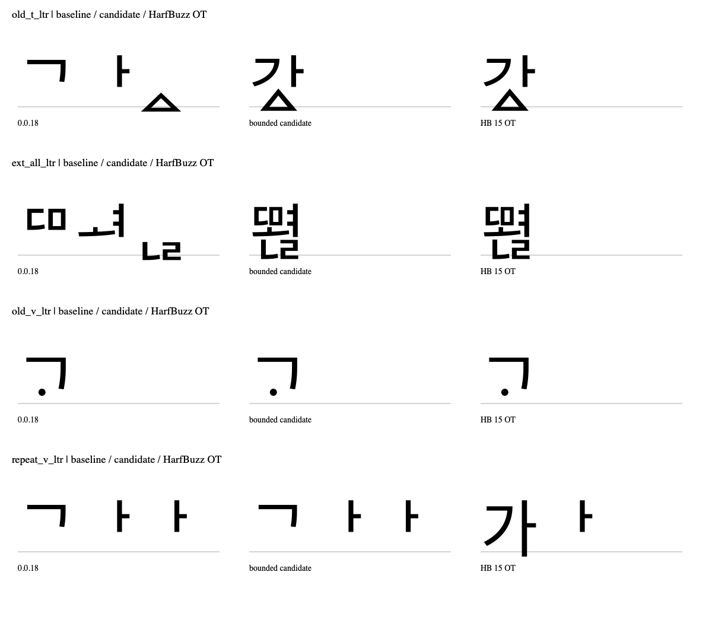

# Bounded Old Hangul Jamo shaping

This original horizontal stage depends on the scalar localized-substitution fix (PR57).
The later [bounded Standard vertical stage](bounded-vertical-hangul.md) has additional admission guards. It is not
complete Korean shaping, language support, or browser parity.

With layout, Standard horizontal LTR and Normal variant, a same-face run may use
a transactional Jamo candidate only when every original extended grapheme is
exactly L V [T] and each contains an archaic/extended Jamo. L ranges are
1100–115E/A960–A97C, V 1161–11A7/D7B0–D7C6, T 11A8–11FF/D7CB–D7FB.
At most 256 glyphs are admitted. Modern composition runs first and stays unchanged.

Fillers, repeated Jamo, tones, marks, selectors, join controls, precomposed
syllables, unrelated text, non-normal variants, RTL, vertical and sideways
orientation reject the candidate. This deliberately means adding an ordinary
neighbor may select legacy shaping for the whole same-face run.

## Selection and safety
Select hang only, requested LangSys when found, otherwise default; never merge
unrelated scripts/languages. Any required feature or unsupported default GSUB
feature (rvrn/ltra/ltrm/abvm/blwm/mark/mkmk/curs/dist/kern) rejects the candidate.
FeatureVariations are not evaluated by this plan.

HarfBuzz 15 puts locl/ccmp, jmo, and common horizontal features in the same
LookupList-ordered stage. This subset unions masks for ljmo/vjmo/tjmo and
locl/ccmp/rlig/rclt/clig/liga, applying each selected lookup once. Source
categories, not substituted IDs, own jmo masks. calt is disabled only inside
this all-Jamo candidate, never globally or on mixed legacy runs.

The private executor supports direct Single, Extension-to-Single, and
ChainContext3 with exactly one input/one action at SequenceIndex0 targeting a
direct or Extension Single. Backtrack/lookahead are context, not targets.
No filtered skipping is enabled; flagged lookups, applicable unsupported
substitutions, invalid nested paths, missing output or work-limit failure discard
the complete clone. Matching ccmp ligatures also discard it, preserving existing
legacy ccmp-only successes. No expansion/contraction is ever accepted, so later
count restoration cannot hide lost source ownership. The 16384 dispatch budget
bounds lookup/subtable execution, not coverage/ligature-record scan complexity.

Outputs preserve original scalar source intervals and ch; unproven simple-mark
ownership is cleared. Family probing requires both candidate and legacy coverage,
since later grouping can reject the candidate. Raw scalar and no-layout routes
stay unchanged. This does not repair generic contextual fallback.

## Verification
Original MIT synthetic fixture generator and TTC: tests/fixtures/generate_bounded_hangul.py.
Regressions cover masks/context, shared lookup deduplication, extension,
LookupList order, wrong script, unsupported shapes/flags, missing targets,
required feature rejection, source intervals, work budget, family grouping,
exclusions and no-layout behavior. Existing modern composition suite remains applicable.
Real-font comparison uses official OFL Noto Sans CJK KR 2.004 and read-only installed
Apple SD Gothic Neo, HarfBuzz 15.0.0. Exact final comparison results are recorded
separately; do not infer parity from aggregate advance alone.

Remaining: precomposed LV+old T decomposition, fillers/repeated Jamo, tones and
dotted circles, mixed runs, vertical positioning, broader supported lookup forms,
variable feature selection, and actual browser/native GUI testing.

References:
- https://learn.microsoft.com/en-us/typography/script-development/hangul
- https://raw.githubusercontent.com/harfbuzz/harfbuzz/15.0.0/src/hb-ot-shaper-hangul.cc
- https://raw.githubusercontent.com/harfbuzz/harfbuzz/15.0.0/src/hb-ot-shape.cc

## Recorded validation
Production checkpoint: 7483cd25939ad137ee78c0e38f1e9fb62d6d6820, based on
6f45454c774660de6db57adc696529319a3a96cc (PR57). Subsequent changes add tests/docs and an equivalent mask-iterator lint cleanup.
Noto font SHA256: 6bcb2a0703aa137e874fc2dffa85f6c21ba9a67fa329e81b8c801663af7e992a.
fontTools 4.68.0, uharfbuzz 0.57.0, HarfBuzz 15.0.0 with explicit OT shaper.
HB uses Hang/ko throughout, including the fontcore None/hang locale controls.
Nominal font size equals hhea ascender-minus-descender-plus-lineGap to normalize
fontcore positions to design-unit scale 1.

144 cases: 9 Noto LTR results changed, all 9 now match HB glyph IDs and total
advance; the other 135 public outputs remain identical to 0.0.18. All 144
trace-only outputs exactly equal the uninstrumented public probe. Apple coverage
failures remain failures, not evidence of support. Final local suites: default
422 passed, no-default-features 242 passed, all-features 540 passed (including doctests).
These are local results, not CI. Final strict clippy (all-targets/all-features),
fmt, fixture byte regeneration and all 49 concrete manifest hashes pass.
After the lint-only cleanup, 6 integration and 12 Hangul-related unit tests
were rerun; all 144 public probe outputs still equal the recorded trace outputs.

Static glyph-outline evidence uses measured public positions and diagnostic IDs,
not screenshots or browser shaping. The first two rows now assemble the syllable
like HB. Existing ccmp-only old vowel stays unchanged. Repeated vowels deliberately
remain legacy and still differ from HB (last row). This was visually inspected;
it is not native GUI/browser parity. The source SVG/PNG, 144-case JSON, exact fonts'
metadata and public/trace binaries are retained in the local audit evidence.
